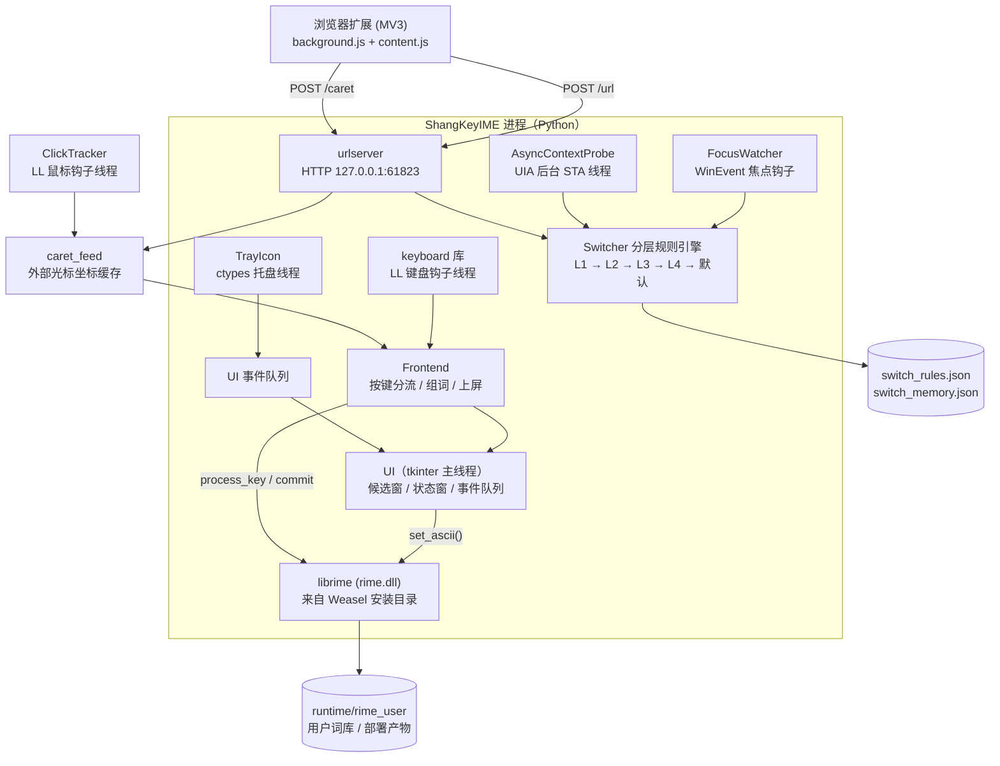

# ShangKey 输入法

基于 [RIME（中州韵）引擎](https://github.com/rime/librime) 的 Windows 中英文输入法原型，Python 实现。两大特色：

1. **自建词库 + 类 VSCode 补全体验**——支持导入 txt / csv / RIME dict / 搜狗 `.scel` 词库，导入词优先于基础词库上屏；
2. **按场景自动切换中英文**——分层规则引擎，写代码、敲命令、逛编程网站时自动切英文，回聊天窗口自动切回中文。

> 当前版本 **v0.3.0**，原型验证阶段（全局键盘钩子方案，非 TSF 标准 IME，见 [8. 已完成与后续计划](#8-已完成与后续计划)）。
>
> 仓库：<https://github.com/lysdgit/ShangKey>

---

## 目录

- [1. 功能总览](#1-功能总览)
- [2. 系统架构](#2-系统架构)
- [3. 快速上手](#3-快速上手)
- [4. 配置说明](#4-配置说明)
- [5. 词库管理](#5-词库管理)
- [6. 打包发布](#6-打包发布)
- [7. 开发过程中遇到的问题与解决](#7-开发过程中遇到的问题与解决)
- [8. 已完成与后续计划](#8-已完成与后续计划)

---

## 1. 功能总览

### 1.1 输入与词库

| 功能 | 说明 | 入口 |
|---|---|---|
| 全拼输入 | librime 引擎，朙月拼音·简化字（简体输出） | 默认 |
| 双拼 | 自然码 / 小鹤双拼，Ctrl+\` 或 F4 弹方案菜单切换 | schema 补丁自动挂载 |
| 模糊音 | rules 配置 `"fuzzy": true`，重启生效 | `switch_rules.json` |
| 简繁切换 | Ctrl+Shift+4 透传引擎开关 | 状态窗显示 中/繁 |
| 词库导入 | txt / csv / RIME dict / 搜狗 .scel，拼音 DP 重切分 | `python -m rimeime.importer <files>` |
| 词库管理界面 | 查看 / 搜索 / 添加（自动注音）/ 删除 / 导出 | 托盘右键 → 词库管理 |

### 1.2 中英文自动切换（特色功能）

分层决策，首个命中生效：

| 层级 | 依据 | 示例 | 状态窗显示 |
|---|---|---|---|
| L1 | 进程名 / 窗口类 / 标题正则 | VS Code、终端、mstsc → 英文 | `英 规则:VS Code` |
| L2 | 网页 URL（浏览器扩展上报） | github.com → 英文；baidu.com → 中文 | `英 规则:编程网站` |
| L3 | UIA 读光标前 60 字符启发式 | URL / 邮箱 / 路径 / camelCase → 英文；中文结尾 → 中文 | `英 上下文` |
| L4 | 手动记忆（Shift 手动切换按进程记录） | 在某进程手动切过英文，下次自动恢复 | `英 记忆` |
| 兜底 | 默认模式 | 中文 | `中` |

辅助行为：焦点切换防抖 150ms、切窗自动清编码、Shift 手动切换优先于自动决策、切换状态跨会话持久化（`switch_state.json`）。

### 1.3 交互与外观

| 功能 | 说明 |
|---|---|
| 候选窗跟随光标 | 四级定位链，按窗口类型分两套优先级：**Chromium 系**（Chrome/Edge/WorkBuddy/微信新版）扩展上报 → 原生插入符（地址栏等浏览器自带输入框）→ 该窗口最后点击位置；**Win32 原生应用** 原生插入符 → 扩展上报 → 点击位置。都没有时用该窗口记住的点击位置 → 鼠标位置 → 窗口中心。插入符做合理性校验、坐标做前台窗口校验、多显示器工作区 clamp；默认弹在光标下方，底部放不下自动翻到上方 |
| 横/竖排候选 | `ui.json` 的 `orientation: horizontal \| vertical` |
| 外观全配置 | 字体、字号、配色、高亮色、不透明度（`runtime/ui.json`） |
| 中英状态小窗 | 默认屏幕右上角，显示当前模式 + 切换来源；**按住左键可拖到任意位置（含副屏）**，松手后位置记入 `runtime/status_pos.json`，下次启动沿用；托盘菜单「语言图标复位到右上角」可回默认位 |
| 翻页键 | `-` `=` 与 `,` `.`（composing 状态下映射 Page_Up/Down） |
| 系统托盘 | 左/右键弹菜单：词库管理 / 暂停拦截 / 开机自启 / 语言图标复位 / 退出 |

### 1.4 快捷键一览

| 快捷键 | 作用 |
|---|---|
| `Shift`（单击） | 手动切换中英文（写入 L4 记忆） |
| `Ctrl+Alt+K` | 开关输入法（暂停/恢复键盘拦截） |
| `Ctrl+Alt+Q` | 退出输入法 |
| `Ctrl+\`` 或 `F4` | 方案菜单（全拼/双拼切换） |
| `Ctrl+Shift+4` | 简繁切换 |
| `1~9` | 数字键选候选 |

---

## 2. 系统架构



- **引擎层**：librime 1.13.1（随小狼毫 Weasel 安装），通过 ctypes 直调；schema `luna_pinyin_simp` + 自定义词库 `shangkey.dict.yaml`。
- **前端层**：Python + tkinter。LL 键盘钩子拦截按键 → rime `process_key` 组词 → 候选窗展示 → 数字键选词后 `SendInput`（KEYEVENTF_UNICODE）上屏。
- **决策层**：Switcher 每 30ms tick 驱动，焦点事件防抖后按层决策，结果经 `set_ascii` 下发引擎。
- **定位层**：`caret.get_input_pos()` 四级链——原生插入符 / 扩展上报 / 该窗口最后点击位置 / 窗口兜底。Chromium 系窗口把「扩展上报」放在首位（网页输入框没有 Win32 插入符），但保留原生插入符在 click 之前（地址栏、查找框只有原生准）。兜底的「窗口中心」已废弃为主选，改用该窗口记住的点击位置与鼠标位置（原因见 §7.3）。

---

## 3. 快速上手

### 3.1 前提条件

| 依赖 | 说明 |
|---|---|
| Windows 10/11 x64 | 开发验证平台 |
| [小狼毫 Weasel](https://rime.im/download/) | 提供 `rime.dll` 与共享方案数据（注册表自动定位） |
| Python 3.14 + venv | 项目使用 tk venv（含 tkinter/keyboard/pywin32） |

### 3.2 方式一：运行打包版（推荐）

从 [Releases](https://github.com/lysdgit/ShangKey/releases) 下载 `ShangKeyIME-v0.3.0-win64.zip`（exe + 纯净 `runtime/` + 启动说明），解压到任意目录：

```text
1. 解压，得到 ShangKeyIME.exe、runtime/、启动说明.txt
2. 双击 ShangKeyIME.exe
3. 托盘出现蓝色「中」图标即启动成功
```

- exe 依赖本机已安装 Weasel；运行数据在 exe 旁 `runtime/` 下自动生成。
- 开机自启：托盘右键勾选「开机自启」，或 `python -m rimeime.autostart on`。

### 3.3 方式二：源码运行（开发模式）

```bash
git clone https://github.com/lysdgit/ShangKey.git
cd ShangKey
pip install -r requirements.txt
python -m rimeime.main
```

> Windows 自带的 python 若缺 tkinter，请换带 tk 的发行版/虚拟环境；
> 本机开发用的 venv 路径见 [6. 打包发布](#6-打包发布)。

其他入口：

```bash
python -m rimeime.main --version    # 版本号
python -m rimeime.main --selftest   # 无头自测（引擎/切换/UI 全链路断言）
python -m rimeime.main --rules <json> --memory <json>   # 自定义规则/记忆文件
python -m rimeime.dictmgr           # 词库管理界面（独立进程）
python -m rimeime.autostart on|off|status   # 开机自启
```

### 3.4 开始打字

1. **系统输入法切到英文/ENG**（否则字母被系统拼音截走，候选窗收不到键）；
2. 聚焦任意可输入窗口（如记事本），直接打拼音，如 `keyi`；
3. 数字键 `1` 选词上屏「可以」；
4. 到 VS Code / 终端等窗口，状态窗自动变「英」——本程序停止拦截，键盘直通英文。

### 3.5 安装浏览器扩展（URL 切换 + 候选窗跟随光标）

1. Chrome/Edge 打开 `chrome://extensions`（或 `edge://extensions`）；
2. 开启「开发者模式」→「加载已解压的扩展程序」；
3. 选择 `runtime/browser-extension/` 目录；
4. 扩展做两件事：
   - **活动标签页 URL** → `POST /url`，`编程网站`、`中文网站` 规则生效；
   - **输入框光标屏幕坐标** → `POST /caret`，网页里打时候选窗精确贴住光标。

> **已装过旧版扩展的必须重载**：`runtime/browser-extension/` 里新增了
> `content.js`（光标测量），版本升到 1.1.0。在 `chrome://extensions` 点该扩展的
> 刷新图标即可；重载后建议刷新已打开的标签页（旧的没注入 content script）。

**为什么网页里必须要扩展**：Chrome / Edge / Electron 不向 Windows 暴露插入符，
`GetGUIThreadInfo` 取不到，UIA 在 Chromium 上直接返回 `E_NOTIMPL`（详见 §7.3）。
只有浏览器内的 JS 才知道光标在哪儿，所以靠扩展上报。没装扩展时不会报错，
自动退到「最后鼠标点击位置」——候选窗出现在你点击输入框的地方，不再跑到窗口顶部。

### 3.6 冒烟测试

```bash
# IME 运行中执行：自动开记事本 → 注入 keyi → 验证「可以」上屏 → 关窗
python runtime\demo_keyi.py
```

---

## 4. 配置说明

所有配置集中在 `runtime/`，改完重启 IME 生效：

| 文件 | 作用 |
|---|---|
| `switch_rules.json` | 切换规则（L1/L2）、模糊音、层级开关、防抖、默认模式。字段：`name / mode(zh\|en) / process / cls / title / url`（含 `url` 字段即 L2 规则） |
| `switch_memory.json` | L4 手动切换记忆（自动维护，可手改） |
| `switch_state.json` | 会话间状态持久化（自动维护） |
| `ui.json` | 候选窗/状态窗外观（字体、字号、配色、orientation、opacity）；删除则用内置默认 |
| `status_pos.json` | 语言图标（状态小窗）的位置记忆（自动维护）；删除或托盘「语言图标复位」即回右上角 |
| `rime_user/shangkey.dict.yaml` | 导入词库产物（importer/dictmgr 维护，勿手改） |

新增一条 L1 规则示例：

```json
{ "name": "Photoshop", "process": ["Photoshop"], "mode": "en" }
```

---

## 5. 词库管理

### 5.1 命令行导入（批量）

```bash
python -m rimeime.importer <词库文件...> [--dry-run] [--no-deploy] [--no-stop-ime]
```

- 支持：`txt`（拼音 词 [权重]）、`csv`、RIME `dict.yaml`、搜狗 `.scel`；
- `--dry-run` 只解析不写盘；导入过程自动退出运行中的 IME（LevelDB 部署锁）并重部署，部署后抽查导入词是否进候选；
- 拼音规范化对齐 luna_pinyin（ü→v、nue→nve 等）；带空格/未切分的拼音用 DP 重切成合法音节，非法条目丢弃并在日志报告。

### 5.2 图形界面（日常维护）

托盘右键 → **词库管理…**：搜索（拼音去空格匹配）、添加（pypinyin 自动注音）、删除、导出、「应用并重启输入法」。

---

## 6. 打包发布

### 6.1 本地构建

```bash
# 需要带 tkinter + pyinstaller 的解释器（Windows 官方安装版自带 tk）
pip install -r requirements.txt "pyinstaller>=6.22"
python tools/build_exe.py
```

产物：

| 产物 | 说明 |
|---|---|
| `dist/ShangKeyIME.exe` | PyInstaller onefile + noconsole 单文件，图标为蓝底白「中」 |
| `dist/runtime/` | 随包配置（规则/外观/图标/浏览器扩展），用户库与部署缓存首次运行自动生成 |
| `dist/ShangKeyIME-v<版本>-win64.zip` | 发布包：exe + 纯净 `runtime/` + README + 启动说明，解压即用 |

> 发布包的 `runtime/` 按白名单重新 staging，**不含** `installation.yaml` / `user.yaml`（本机 `installation_id`）与 `build/`、`userdb/` 运行数据。

版本号在 `rimeime/__init__.py` 的 `__version__`，`--version` 可查；发版小步递增（0.3.0 → 0.3.1）。

### 6.2 自动发版（GitHub Actions）

[`.github/workflows/release.yml`](.github/workflows/release.yml)：push 形如 `v*` 的 tag 时，在 `windows-latest` 上装依赖 → `import` 全模块自检 → `python tools/build_exe.py` → 校验 exe 体积与 zip 条目（防本机配置泄漏）→ 上传 artifact 并挂到 GitHub Release。

发版三步：

```bash
# 1. 改 rimeime/__init__.py 的 __version__ = "0.3.1"
git commit -am "release: v0.3.1"
git tag -a v0.3.1 -m "v0.3.1"
git push origin main v0.3.1        # 推送 tag 即触发构建与发版
```

也可以在 Actions 页面手动 **Run workflow**：只构建并保留 artifact，不创建 Release（用于验证 CI 是否健全）。

---

## 7. 开发过程中遇到的问题与解决

### 7.1 引擎与词库

| 问题 | 根因 | 解决 |
|---|---|---|
| 候选第一是生僻字「㕉ㄧ」而非「可以」 | 生成的词典 `use_preset_vocabulary: false`，导入词权重全 0；且测试脚本反复选第一候选，把垃圾候选固化进 userdb | 模板改 `true`；清空 userdb 重部署；测试脚本不再自动选第一候选 |
| 真实搜狗 .scel 解析失败 | ① 词记录字段顺序是 `(word_len, 词, ext_len, ext)`，旧实现误为 `(word_len, ext_len, 词)`——合成测试文件按同样错误生成，从未暴露；② 新版拼音表头 0x1540 是 u32 条目计数，无界行走会把词组头误吃成拼音条目；③ 文件尾部有联想/示例附属段 | 按开源 scel2txt 交叉验证重写解析器：计数严格截断 + 分隔符跳过 + 尾部宽松停止；7356 词全部解析成功 |
| 部署时 LevelDB 报锁 | IME 运行中占用 userdb | 导入器自动探测 IME（CreateMutexW）→ 发 Ctrl+Alt+Q 退出 → 部署 → 抽查 |

### 7.2 Windows / ctypes 层

| 问题 | 根因 | 解决 |
|---|---|---|
| 托盘窗口创建失败 / access violation（x64） | Win32 调用未声明 argtypes/restype，HMODULE/HICON 等句柄按 32 位截断；`DefWindowProcW` 截断致 WM_NCCREATE 回调 OverflowError；`HWND_MESSAGE` 误当 user32 导出；`Shell_NotifyIconW` 误从 user32 找 | 全量声明 20+ 函数原型；HWND_MESSAGE 常量化为 -3；Shell_NotifyIconW 归 shell32 |
| WinEvent 焦点钩子「静默失效」 | 回调原型少声明一个参数，ctypes TypeError 被 `Exception ignored` 吞掉 | 严格按 7 参数声明 WinEventProc；教训：**ctypes 回调异常不会显式报错** |
| UIA 上下文探测导致记事本注入全丢 | COM UIA 调用阻塞主线程 | AsyncContextProbe 后台 STA 线程 + TTL 缓存，decide 只读 latest() |
| 打包版/pythonw 启动即崩 | 无控制台下 `print` 写 None stdout；函数内 `from .paths import PROJECT_ROOT` 把模块名遮蔽成局部变量（UnboundLocalError） | stdout None 兜底重定向到 `runtime/ime.log`（buffering=1）；PROJECT_ROOT 全部模块级导入 |
| faulthandler 抓不到崩溃 | fastfail 类硬崩溃绕过 SEH | 叠加证据链定位：控制台日志 + WER 事件日志 + 排除法；最终确认 x64 截断根因（见 7.2 第一条） |

### 7.3 自动切换与测试

| 问题 | 根因 | 解决 |
|---|---|---|
| `keyboard.write` 注入测试完全绕过自家 IME | Windows 上默认走 type_unicode（VK_PACKET），不产生真实键盘事件 | 测试一律逐字符 `keyboard.send(ch)` |
| 注入 Shift 后后续按键不落地 | keyboard 库注入伪影：事件穿过全部钩子但系统拒绝派发 | 与 IME 无关；Shift 链路测试改用 L4 记忆写入断言 |
| URL 变化不触发重判 | 窗口焦点没变，原逻辑只在焦点事件时决策 | 扩展上报回调里主动触发 re-decide |
| demo 打字进错窗口（任务管理器/WorkBuddy） | 后台进程 `SetForegroundWindow` 被系统前台锁拒绝 | `keybd_event` ALT down/up 解锁 + `SwitchToThisWindow` + 激活校验重试 |
| 「进程静默死亡」假象 | ① 沙箱作业在命令结束时清理后台子进程；② 控制台 stdout 全缓冲，日志尾部滞留像中途崩溃；③ 孤儿 IME 多实例并存，旧实例 Tk 隐藏窗口霸占前台吞掉所有输入 | 测试单命令内完成；`-u` 无缓冲；每轮测试前 `taskkill` 清场 |
| 候选窗抢焦点吞掉上屏文字 | tkinter `deiconify` 激活无边框置顶窗，夺走目标应用焦点 | 候选窗/状态窗设 `WS_EX_NOACTIVATE | WS_EX_TOOLWINDOW`（真实输入法候选窗的标准做法） |
| PyInstaller 装不上 cp314 轮子 | tuna 镜像快照过旧（最高 6.9） | 换 aliyun 镜像装 6.22.3 |
| 语言图标拖走后，一切换中英又跳回右上角 | `StatusWindow.set()` 每次都按屏幕宽度重新右对齐，把拖动结果冲掉 | 区分两种摆放：**拖过的位置钉左边缘**（宽度变化只向右长）、未拖过才走右对齐；拖动途中 `set` 不重排，避免抖动 |
| 担心 NOACTIVATE 窗口收不到拖动事件 | 鼠标消息只要求命中测试，不要求窗口激活；Tk 在 ButtonPress 时 `SetCapture`，拖到窗口外仍持续收 Motion | 直接绑 `<Button-1>/<B1-Motion>/<ButtonRelease-1>`；点击不移动不写盘，松手才落盘。实测 6/6 PASS（跟随/写盘/钉住/复位/单击不动/重启恢复） |
| 退出后 Tcl 报 `invalid command name "...poll"` | 销毁 root 时队列里还排着 30ms 的 `after` 回调 | `poll()` 入口先 `winfo_exists()` 探测，`TclError` 直接收摊 |

### 7.4 候选窗定位（Chromium 系应用）

记事本里候选窗贴得住光标，Chrome / WorkBuddy 里却跑到窗口角落——这一轮排查的结论值得记下来。

| 问题 | 根因 | 解决 |
|---|---|---|
| Chrome / Edge / Electron 拿不到插入符 | 这三类应用都自绘文本，不设置 Win32 插入符，`GetGUIThreadInfo` 的 `rcCaret` 恒为 0 | 走浏览器扩展上报（网页内 JS 有 `Selection` / 镜像测量，是唯一精确来源） |
| UIA 兜底在 Chrome 上完全没用 | `GetCurrentPattern(UIA_TextPatternId)` 返回 `E_NOTIMPL`（-2147467263）。MSAA 树能取到 267 个节点，但全是浏览器 UI（标题栏按钮、信息栏），**网页内容根本没暴露**；`SPI_SETSCREENREADER` 强制开启读屏标志也失败（返回 0）。Chromium 只在确认有 AT 客户端时才建 renderer 可访问性树，不值得为此改系统设置 | 放弃可访问性路线，改用扩展 + 点击位置双通路 |
| Electron 应用（WorkBuddy 等）连扩展也装不上 | 无注入点，进程内 JS 不可达 | 加 LL 鼠标钩子记录最后点击位置——用户点输入框的位置就是他要输入的地方，比「窗口顶部中央」准得多 |
| 扩展上报的坐标恒定偏下 8px | `outerHeight - innerHeight` 里混进了**底部窗口边框**：Windows 10 的 Chrome 四周各有 8px 不可见边框，`outerWidth - innerWidth = 16`。垂直方向算出来是「顶部 chrome 高度 + 底部边框」 | 边框宽度 `b = (outerWidth - innerWidth) / 2`；`origin = (screenX + b, screenY + outerHeight - innerHeight - b)`。校准后 3/3 点误差 0px（工具：`tools/coord_check/`） |
| 上报坐标串到别的应用 | 上报来自某个标签页，前台可能已经切走 | 上报带页面标题，前台窗口标题必须包含它才采用；再叠加「坐标必须落在前台窗口矩形内」校验 |
| 候选窗横向离光标很远（偏右） | 没有精确来源时落到「窗口中心 + 顶部 48px」兜底：1920 宽的窗口里 x=960，而输入框在左侧，于是既偏右又偏上 | 兜底改为按序取 **该窗口记住的点击位置 → 鼠标位置 → 窗口中心**；点击位置从「全局 90 秒」改成「按窗口记忆 30 分钟」，切走查完资料再切回来依然有效 |
| 地址栏里打字候选窗反而乱跑 | 一度把 Chromium 的原生插入符降到最后——但地址栏、查找框恰恰只有原生准（扩展管不到浏览器 UI） | 顺序定为 **扩展上报 → 原生插入符 → 点击位置**；原生插入符同时做合理性校验（高 6~160px、宽 ≤40px，否则视为控件矩形直接丢弃） |
| 定位来源查不出来 | —— | `SHANGKEY_DEBUG_CARET=1` 启动输入法，每次组词打印 `[caret] source=… native=… ext=… click=…`，落盘在 `runtime/ime.log` |

---

## 8. 已完成与后续计划

### 8.1 已完成（M1~M4 + 工程化收尾）

- ✅ librime ctypes 绑定 + 命令行验证（#1 #2）
- ✅ 悬浮候选窗 + 键盘钩子 + SendInput 上屏原型（#3）
- ✅ 词库导入器：txt/csv/RIME dict/搜狗 .scel、DP 拼音重切分、去重合并、部署联动（#4~#7）
- ✅ 分层切换引擎：L1 进程规则 / L2 URL（浏览器扩展）/ L3 UIA 上下文 / L4 手动记忆 + 状态持久化（#8~#14）
- ✅ 体验完善：候选窗光标跟随与多显示器 clamp、翻页键、模糊音、双拼、简繁、外观配置（#15~#19）
- ✅ 工程化：词库管理界面、系统托盘、开机自启、真实 scel 回归、PyInstaller 打包发布（#20~#23）
- ✅ 开源发布：代码开源到 [lysdgit/ShangKey](https://github.com/lysdgit/ShangKey)，`v0.3.0` 提供 exe 与完整发布包下载
- ✅ CI 自动发版：GitHub Actions 监听 `v*` tag，自动构建 exe + 发布包并挂 Release（见 [6.2](#62-自动发版github-actions)）
- ✅ Chromium 系应用候选窗定位：扩展上报光标 + 鼠标点击兜底（#24）

### 8.2 后续计划

| 优先级 | 事项 | 说明 |
|---|---|---|
| 高 | 用户实机体验打磨 | 长期使用暴露的手感问题（候选延迟、误切换、词频调优） |
| 高 | 词库扩充 | 按需导入更多词库（如 `runtime/scel_test/it.scel` 网络流行新词 7356 条已就绪，一条命令导入） |
| 中 | L3 启发式增强 | 更多上下文模式（代码块内、Markdown、聊天软件 @提及 等） |
| 中 | 候选窗富文本高亮 | 竖排模式下第一候选高亮渲染 |
| 中 | 托盘图标状态联动 | 图标随中英状态切换 / 暂停时变色 |
| 低 | **TSF 标准输入法改造**（远期） | 当前是全局钩子方案：优点是跨应用通用、无需注册 IME；缺点是无法进入系统 IME 框架（无语言栏指示、UAC 提权窗口拦截失效——已降级为进程级规则）。正式版需 C++/Rust 实现 TSF Text Service |
| 低 | 安装向导 | 目前进度 |

---

*文档对应代码版本 v0.3.0（2026-10-22）。架构细节可对照 `rimeime/` 各模块 docstring 与 `.workbuddy/memory/` 开发日志。*
